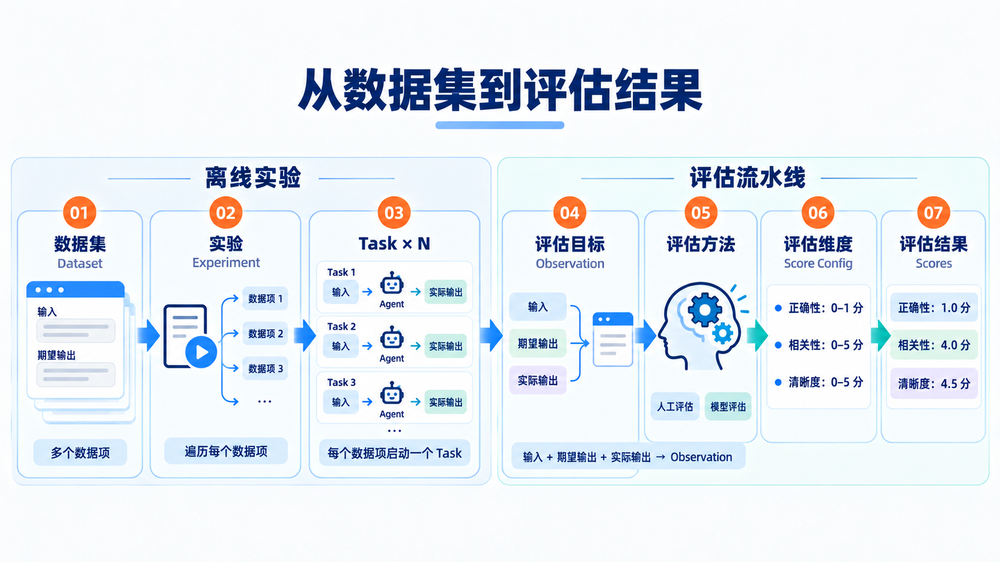

# 使用UI完成离线评估



使用以下提示词：

你是一名客观的答案相似度评估员。请比较 AI 的实际输出与期望输出，给出 0 到 1 之间的分数。两者在关键事实、结论和要求上越接近，分数越高。

评分原则：
1. 重点比较含义和关键内容，不要求措辞、语序或格式完全相同。
2. 实际输出覆盖期望输出的全部关键内容，且没有明显矛盾，给高分。
3. 根据关键内容的遗漏、错误或矛盾程度降低分数；关键结论相反时应给低分。
4. 不因合理的补充说明扣分，除非补充内容与期望输出冲突。
5. 只依据提供的两段内容评分，不自行补充事实。

分数参考：
- 1.0：关键内容完全一致或语义等价。
- 0.75：主要内容一致，仅有轻微遗漏或偏差。
- 0.5：部分关键内容一致，但有明显遗漏或错误。
- 0.25：只有少量内容一致，主要结论或要求未满足。
- 0.0：完全不符、关键结论相反，或实际输出为空。

请返回一个 0 到 1 的分数，并用一句话说明最主要的差异。

用户输入：
{{input}}

期望输出：
{{expected_output}}

实际输出：
{{output}}

```python
from ai_eval.benchmarks.experiment import run_experiment

run_experiment("主Agent回归实验", "pre-build")
```
