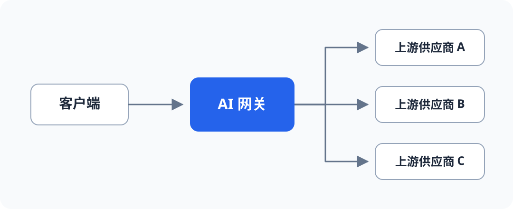

# AI网关服务选型

## 为什么需要网关

以下都是生产环境中会真实遇到的问题：

1. 不同上游供应商接口不统一怎么办？
2. 并发量超过供应商阈值导致失败怎么办？
3. 供应商服务挂了怎么办？
4. 供应商模型更新导致模型不可用了怎么办？
5. 成本超过上限后怎么办？
6. 错误如何重试？
7. 如何统一、优雅的管理各种模型？
8. ....

以上问题都需要通过 **AI网关** 解决

## 常用 AI 网关服务

| 产品名称 | 是否支持自部署 | 特点 |
| -------- | -------------- | ---- |
| [LiteLLM](https://www.litellm.ai/) | ✅ | 完善、成熟的企业级AI网关 |
| [Bifrost](https://www.getmaxim.ai/bifrost) | ✅ | 轻量级、高性能的AI网关，兼容性和成熟度还不完善 |
| [Higress](https://higress.io/) | ✅ | 通用型网关，阿里系，目前还在孵化当中，功能不完善 |
| [OmniRoute](https://github.com/diegosouzapw/OmniRoute) | ✅ | 偏向个人中转站 |
| [New API](https://github.com/QuantumNous/new-api) | ✅ | 偏向第三方中转站 |
| [阿里云 AI 网关](https://help.aliyun.com/zh/api-gateway/ai-gateway/product-overview/what-is-an-ai-gateway) | ❌ | 托管服务 |
| [火山引擎 API 网关（AI 网关）](https://docs.volcengine.com/docs/apig/AI_Multi-Model_Proxy?lang=zh) | ❌ | 托管服务 |
| [腾讯云 AI 网关](https://cloud.tencent.com/document/product/1826/134817) | ❌ | 托管服务 |
| [Amazon API Gateway + Bedrock](https://aws.amazon.com/blogs/architecture/building-an-ai-gateway-to-amazon-bedrock-with-amazon-api-gateway/) | ❌ | 托管服务 |
