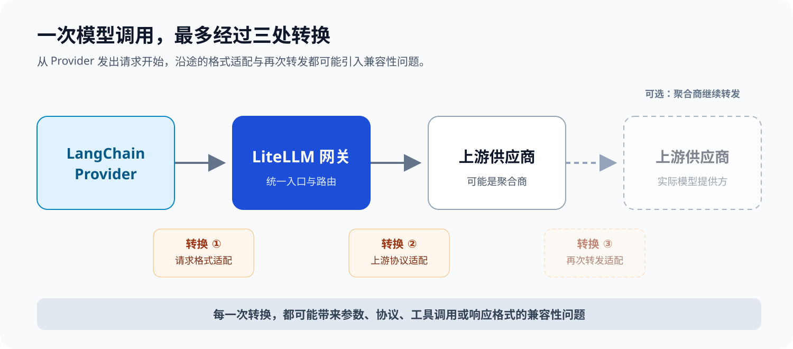

# 兼容性问题的最佳实践

- **统一接口风格**

  - 使用`Open AI Chat Completion`

    缺陷：接受 `langchain` 环境下丢失思维链的问题（可以通过补丁弥补）

    优点：兼容性最好，模型最全

  - 使用`Open AI Response`

    缺陷：接受 `langchain` 环境下丢失思维链的问题（可以通过补丁弥补），模型不全，兼容问题非常多

    优点：模型功能最全

  - 使用`Anthropic`

    缺陷：部分主流模型支持，仍然有一些兼容性问题

    优点：`langchain` 环境下自带完整思维链

- **直连供应商官方模型**

  不要让上游供应商做二次转发

- **线下模型和线上模型统一**

  尽量保证本地开发环境的模型和线上模型一致，否则至少会有以下问题：

  - 本地的线下评估能通过，但线上无法通过
  - 本地的兼容性能跑通，但线上有兼容性问题

  如果将来要切换模型，必须重新测试受到新模型影响的功能。

- **兼容性可控**

  兼容性问题无法完全避免，应该尽量将兼容性问题放到代码可控的环节。

