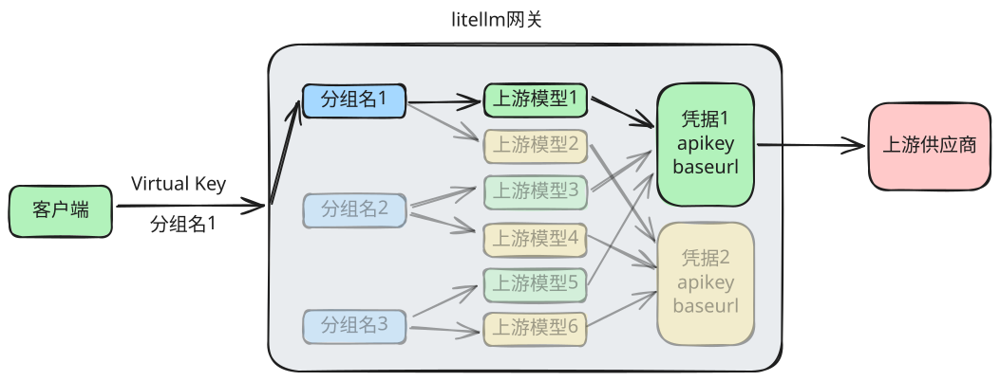

# 网关访问链路

## Provider

上游供应商，比如 Deepseek、百炼、月之暗面、智谱、OpenAI、...

## Credential

凭证，一个凭证包含：

- Provider
- Base Url
- API Key

最佳实践：

- 至少包含三个账号独立的凭证，以便实现熔断+降级
- 证书名称建议设置为：`<Provider>-<账号>-<Key编号>`，全英文

## Deployement

一个 Deployeement （模型部署）包含：

- 上游供应商的一个模型
- 模型分组名（public model name）
- 使用的证书

分组名的最佳实践

`类型-能力`

类型：chat、vision、embedding、...

能力：basic、standard

| 类型/能力 | basic                                            | standard                                         |
| --------- | ------------------------------------------------ | ------------------------------------------------ |
| chat      | 处理简单问答、摘要和文本改写。                   | 处理多轮对话、较复杂的指令和日常内容生成。       |
| vision    | 识别图片中的主要内容， 回答简单的看图问题。 | 理解图片中的细节、图表和文档页面。               |
| embedding | 为短文本生成向量，支持基础语义检索。             | 为一般文档生成向量，支持知识库检索和相似度匹配。 |

## Virtual Key

创建一个 Virtual Key，用于你的客户端和 LiteLLM 交互。
