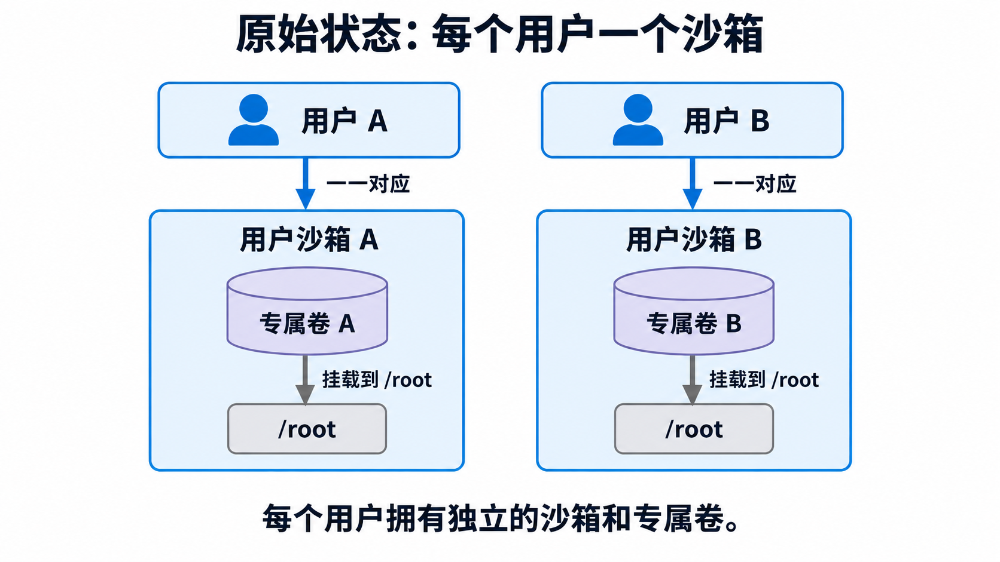
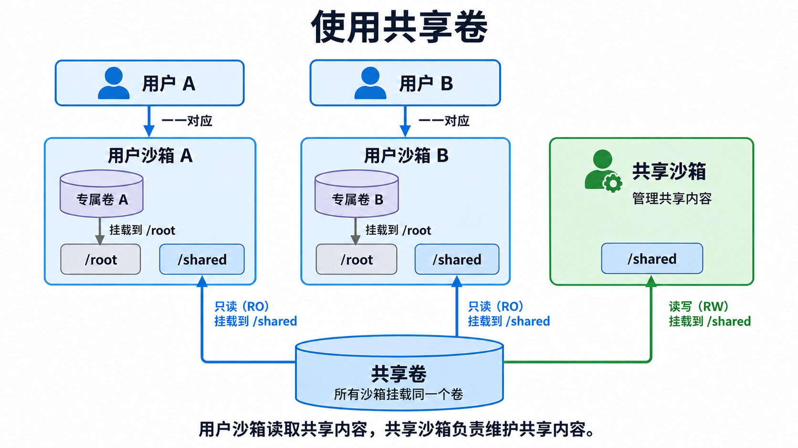

如果将 Skill 挂到专属卷，有以下问题：

1. 有多少个用户，就要重复占用多少的存储空间。
2. 有多少个用户，就要同步多少次 Skill。
3. 如果 Skill 发生了变动，就必须重启每个用户沙箱从而改变它的 Skill ，尽管目前用户根本没有用到沙箱。
4. 如果 Agent 执行期间改变了 Skill，就难以跟踪和分析。

1. 无论有多少个用户，共享的数据只有一个卷，不重复占用空间。
2. Skill的同步只需要同步到共享卷，和用户无关。
3. Skill的变化只需要通过共享沙箱去改变共享卷即可。
4. 由于共享卷对用户沙箱是只读的，因此 Agent 无法改变共享 Skill 的内容。
