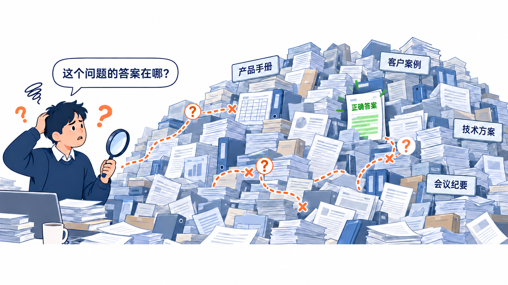
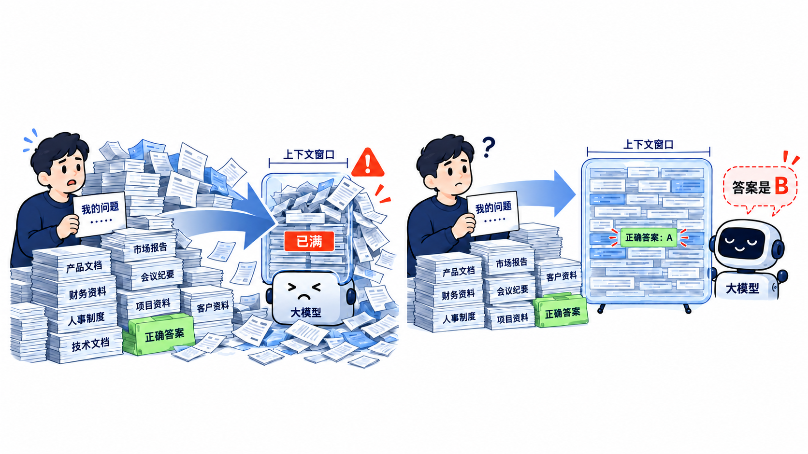
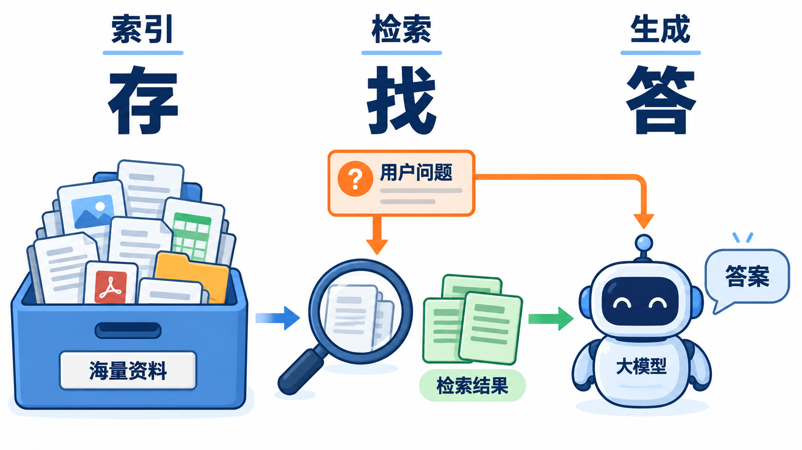

# RAG系统概览

## 企业中的问题

企业拥有庞大的资料库：

- 客服岗位涉及的资料包括：产品资料、故障资料、服务规则、业务流程、历史记录...

- 销售岗位涉及的资料包括：产品资料、价格资料、方案资料、案例资料、竞品资料、客户资料...
- ...

庞大的资料库带来的问题

- **查询效率低**

  资料分散、数量庞大，员工需要反复查找、核对，难以及时获得准确答案。

- **培训成本高**

  新员工培训周期长；业务熟悉过程边际效应明显；人员流动带来持续的企业知识磨损。

- **信息不同步**

  企业经营过程中不断产生新的信息，经常会出现信息不一致、理解不一致的情况。

- **交易风险**

  员工可能带着有误的理解或查询到了过时的资料，对客户做出不正确的承诺，导致企业损失。

- **机会流失**

  员工无法及时找到合适的产品、方案或案例，客户等待过久，导致成交机会流失。

  投标书、报价方案等交付时限紧，资料分析不充分，方案难以细化，影响竞争力和成交率。
  
- **重复劳动多**

  已有方案和经验难以复用，不同员工、团队重复调研、分析和编写资料，增加人力成本。

- **协作成本高**

  员工难以自行找到答案，反复向同事求助，打断他人工作，关键人员成为业务瓶颈。

- **决策依据不足**

  资料难以全面梳理，管理者容易依据局部信息或个人经验做决策，影响资源配置和经营判断。
  
  

### 解决方案：全文检索

全文检索能帮助员工找到相关资料，但后续的阅读、判断和整理仍主要靠人。

- **依赖关键词**

  员工需要知道搜什么；提问与资料用词不同，可能漏掉相关内容。同义词配置可以缓解这一问题。

- **阅读负担仍然大**

  搜索返回相关文档或片段，员工仍需逐一阅读、筛选，才能找到答案。

  很多时候答案分散在多份资料中时，仍需人工关联、比较和整理，难以直接形成方案或结论。

- **难以主动发现机会**

  搜索通常从已有问题出发，资料中尚未被意识到的客户需求、业务规律和潜在商机，仍容易被忽略。

### 解决方案：模型生成

模型生成能直接给予结论，但质量堪忧，原因是：

- **缺乏语料**

  模型训练期间只能获取到公共语料，企业私有数据不在语料库中

- **上下文限制**

  如果强行把企业所有私有数据塞进模型上下文，要么装不下，要么记不住。

## RAG的解决思路

**RAG**（Retrieval-Augmented Generation，检索增强生成）使用：

**索引（Indexing） + 检索（Retrieve） + 生成（Generate）** 

的方案解决上面的问题。

