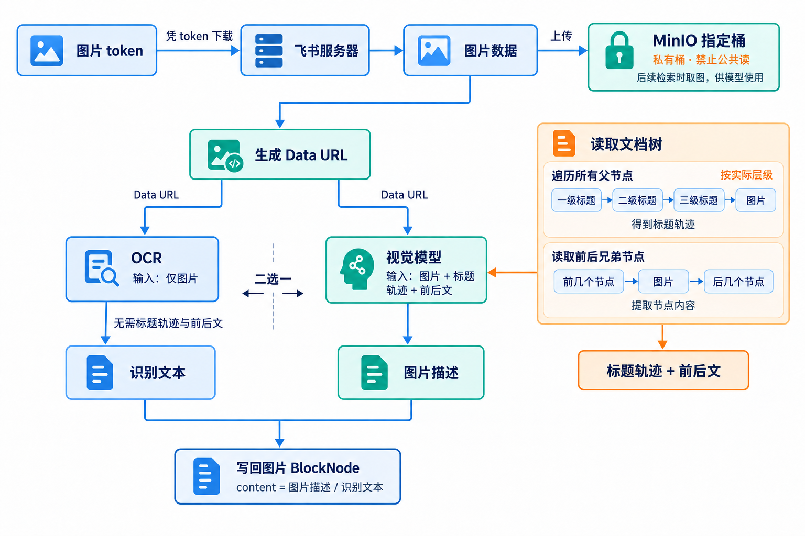

# 文档图片的处理



需要补充的实现（接口与行为约定）：

1. 在 Nacos 中新增 `rag_config` 配置。

   **配置位置与内容**

   - Nacos 服务地址、命名空间和登录信息沿用 `src/deal_pilot/config/nacos_settings.py` 中的 `nacos_settings`。
   - Group：`deal_pilot`。
   - Data ID：`rag_config`。
   - 配置格式：YAML。当前只定义图片解析器配置，示例如下：

   ```yaml
   image_parser:
     bucket_name: feishu-images
     sibling_count: 3
   ```

2. 在 `src/deal_pilot/feishu/api` 中新增图片下载模块。

   传入图片 `token`，返回一个包含以下两个字段的对象：

   - `mime: str`：图片的 MIME 类型，例如 `image/png`、`image/jpeg`。
   - `data: bytes`：图片的原始字节数据。

3. 在 `src/deal_pilot/utils/minio.py` 中新增 `upload_bytes` 函数。

   对标现有 `upload_file`，保留 `bucket_name`、`filename` 参数，将 `source_file` 替换为 `data: bytes`，另外新增 `mime: str` 参数。直接上传字节数据，并使用 `mime` 设置对象的 `Content-Type`；其余行为与 `upload_file` 一致。

4. 调整 `src/deal_pilot/rag/structure/feishu_doc/tree_builder.py` 中的图片后处理。

   完整构树后，按文档顺序串行处理图片节点；当前图片处理完成后，再处理下一张图片，确保读取前面的图片节点时，其内容已经更新。

5. 在 `src/deal_pilot/rag/structure/feishu_doc/image_parser.py` 中实现以下辅助函数。

   **`_generate_dataurl`**

   传入图片字节 `data: bytes` 和 MIME 类型 `mime: str`，返回包含 MIME 类型及 Base64 编码图片数据的 Data URL 字符串。

   **`_upload_minio`**

   传入图片字节 `data: bytes`、MIME 类型 `mime: str` 和 `block_id: str`，将图片上传到 MinIO：

   - 桶名从 Nacos 的 `rag_config.image_parser.bucket_name` 中获取，桶必须禁用公共读。
   - 图片直接存放在桶的根目录下。
   - 文件名由 `block_id` 和 MIME 对应的文件后缀组成，例如 `image/png` 对应 `{block_id}.png`。
   - 上传对象的 `Content-Type` 使用传入的 `mime`。

   返回一个包含以下字段的对象：

   - `bucket_name: str`：图片所在的桶名。
   - `filename: str`：图片在桶中的文件名。

   **`_attachment_info`**

   传入图片 `BlockNode`，返回一个包含以下字段的对象；`n` 从 Nacos 的 `rag_config.image_parser.sibling_count` 中获取：

   - `parent_trace: list[str]`：所有父节点的内容，去除内容为空的节点，按根节点到直接父节点的顺序排列，不包含图片节点自身。
   - `prevs: list[str]`：前面最近的 `n` 个兄弟节点的内容，不跳过图片节点，使用其处理后的内容；返回结果按文档顺序排列。
   - `nexts: list[str]`：后面最近的 `n` 个非图片兄弟节点的内容。遇到图片节点时跳过，并继续向后查找，补足 `n` 个节点；跳过的图片不计入 `n`。返回结果按文档顺序排列。

   前后节点均只在同一父节点的兄弟范围内查找，不跨父节点；可用节点不足 `n` 个时，返回实际找到的内容，无可用节点时返回空数组。
