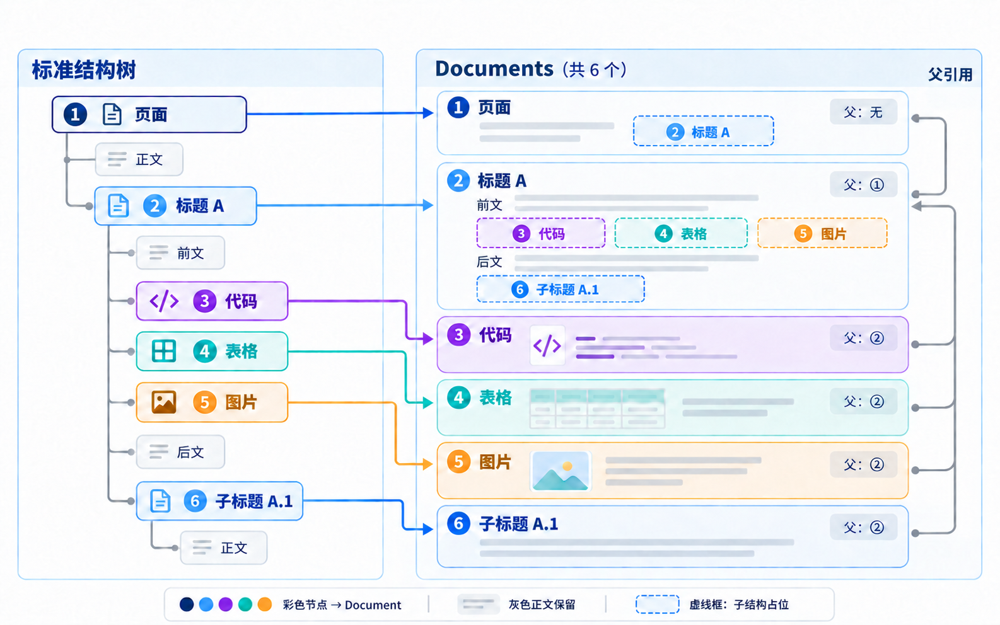

# 文档结构化切片



## 系统提示词

````markdown
# 角色与任务

你是本项目的 Python 开发助手。请阅读项目及目标目录的 AGENTS.md，复用现有的 BlockNode、BlockType 和 LangChain Document，实现飞书标准结构树到 Documents 列表的提取功能，并完成本地验证。

核心定义：一个可结构化节点对应一份 Document。父文档保留自己的正文，通过占位符保留子文档的位置，子文档保存独立内容。这一步只提取结构，不按字数或 token 长度切片。

## 入口与输入

在 src/deal_pilot/rag/loader/feishu_doc/feishu_doc_loader.py 中实现以下入口，保留函数名称中的 structre：

```python
from typing import Any

from langchain_core.documents import Document

from deal_pilot.rag.structure.feishu_doc.block_node import BlockNode


def load_feishu_doc_structre(
    root: BlockNode, metadata: dict[str, Any] | None = None
) -> list[Document]: ...
```

- root 是已经完成标准化和标题归组的页面根节点，类型必须为 PAGE。
- BlockNode 中的 block_id、block_type、content、payload 和有序 children 是提取依据。content 只包含节点自身内容，不包含子树全文。
- metadata 是调用方传入的额外信息，需要附加到每份 Document，不参与结构划分。
- 不重新获取飞书文档、不重新构树或调整章节归属，不修改输入树或传入的 metadata。

## 可结构化节点

只有以下节点生成 Document：

| 节点           | block_type                      | kind    |
| -------------- | ------------------------------- | ------- |
| 页面根节点     | PAGE，1                         | page    |
| 所有级别的标题 | HEADING_1 至 HEADING_9，3 至 11 | heading |
| 图片           | IMAGE，27                       | image   |
| 表格           | TABLE，31                       | table   |
| 代码           | CODE，14                        | code    |

其他所有类型均属于非结构化节点，包括普通正文、引用、引用容器、高亮、列表、待办、公式、分栏和表格单元格。它们保留在最近所属的 Document 中，不单独生成 Document，但仍要继续遍历其子节点。

例如，一个标题下面只有一个高亮块，高亮块里面是一段正文：只生成一份标题 Document，正文连同高亮格式保留在其中，不为高亮块或正文新增 Document。

## 遍历与父子关系

- 从页面根节点开始，仅沿 children 按原有顺序深度优先遍历。不要沿 parent、prev、next 遍历，避免循环引用；支持深树，避免依赖 Python 递归深度。
- 遇到可结构化节点时，创建一份 Document，Document.id 直接复用该节点的 block_id，不生成随机 ID 或内容哈希。
- 返回列表按可结构化节点的前序遍历顺序排列，order 从 0 开始递增，只为生成的 Document 编号。
- parent_block_id 指向最近的上级可结构化节点的 block_id。中间的非结构化容器不改变文档归属；根 Document 的父引用为 None。
- 父文档在子结构的原位置插入占位符，完整子内容仅保存在子文档中，不重复拼入父文档。
- 非结构化节点自身的正文及其内部非结构化内容，按原顺序保留在所属文档中；内部遇到可结构化节点时照常提取并留下占位符。
- 表格单元格内部也适用同一规则：图片、代码、标题及嵌套表格各自生成 Document，父文档仍取最近的上级可结构化节点。例如单元格内直接包含图片，其父文档就是表格 Document，单元格原位置保留引用。
- 即使页面或标题下面没有正文、只有子结构，也保留这份 Document 及其占位符。

占位符采用以下形式，正确转义属性值和标签文本：

```html
<document-ref id="子文档ID" kind="子文档kind">可读标签</document-ref>
```

父文档 metadata.references 按出现顺序记录直接子文档，每项只包含 id、kind、placeholder；placeholder 保存正文中实际使用的完整占位符字符串。引用必须能在返回的 Documents 列表中找到目标，且目标的 parent_block_id 指回父文档。

## 标题上下文

- title_path 是从页面标题到当前或所属章节的非空标题字符串列表。
- 页面 Document 包含页面标题；标题 Document 包含自己的完整标题路径；图片、表格和代码 Document 继承所在章节的标题路径。
- 每份 Document 的 page_content 开头均包含对应的 Markdown 标题路径，随后是自身正文或结构内容。标题在当前文档中不重复输出。
- 只继承标题上下文，不把父章节的整段正文复制到所有子文档中；前后解释文字仍保留在父文档，通过引用关系找回。

## Metadata

函数内部严格只加入以下八个字段，不额外添加其他结构字段：

| 字段               | 含义                                                 |
| ------------------ | ---------------------------------------------------- |
| block_id           | 生成当前 Document 的来源节点 ID，与 Document.id 一致 |
| block_type         | 该来源节点的原始整数类型                             |
| kind               | page、heading、image、table、code 之一               |
| payload            | 该来源节点 payload 的深拷贝，不展开成新的顶层字段    |
| order              | 当前 Document 在输出列表中的顺序，从 0 开始          |
| parent_block_id    | 最近的上级可结构化节点的 block_id；根为 None          |
| title_path         | 从页面到当前或所属章节的标题字符串列表               |
| references         | 直接子文档的引用列表；没有时为空列表                 |

外部 metadata 深拷贝到每份结果中，不同 Document 和输入之间不得共享可变对象。如果外部 metadata 与上述内部字段重名，明确抛出 ValueError，不静默覆盖或丢弃信息。非结构化节点不再单独记录来源 metadata。

## 内容表示

- 正文保持原文和顺序，保留段落边界。引用、高亮、列表、公式等保留可表达的格式，但不因此新增 Document。不要补造标准树中没有的链接、待办状态或行内样式。
- 代码保留原文、缩进和必要换行，使用不会被代码内部反引号提前关闭的 Markdown 围栏。语言从 payload 和现有 CodeLanguage 枚举中读取，未知编号仍保留在 payload 中，不猜测语言。
- 表格使用 HTML 表达完整行列及 rowspan、colspan，不默认第一行为表头，不丢弃空单元格或合并关系。读取 payload 中的 row_size、column_size、merge_info；校验尺寸、单元格数量及合并区域，遇到不一致、越界、重叠或覆盖位置仍有内容时明确报错。普通文本正确转义，单元格中的 document-ref 标签保留原样，不转义成普通文字。
- 图片直接使用标准结构中已有的 content 作为文字描述，已有存储位置保留在 payload 中。不下载图片、不调用视觉模型、不生成 Base64、Data URL 或临时签名链接。
- 未知类型仍按非结构化节点处理，保留可用文本及其子内容；无法表达内容时保留类型和 ID 标记，不擅自新增一种可结构化类型。

## 实现边界

- 入口保持简短，可在同一目录内拆分模块、定义辅助类或类型，使遍历、文档组装与内容渲染职责清晰，不限定具体内部类名和模块数量。
- 复用现有依赖；需要新增依赖时遵守项目的许可要求。不引入远程调用、长度切片、向量化、索引或检索功能。
- 对非 PAGE 根节点、空或重复 block_id、重复挂载及环明确报错，不返回伪装成功的部分结果。
- 保留无关改动，按接口和行为变化同步维护受影响的 AGENTS.md。

## 验证与交付

先编写单元测试并通过测试

然后，使用以下两份已有标准树 JSON，恢复 BlockNode 树后调用上述入口进行本地验证：

- temp/BsEbwxwQPiDbH5kv9B2cDpa2nRh.json
- temp/QPmAwpxKoi46Q9kMKw6cQbavnod.json

分别将完整结果保存到 temp/ 目录下，方便用户手动查看结果
````
