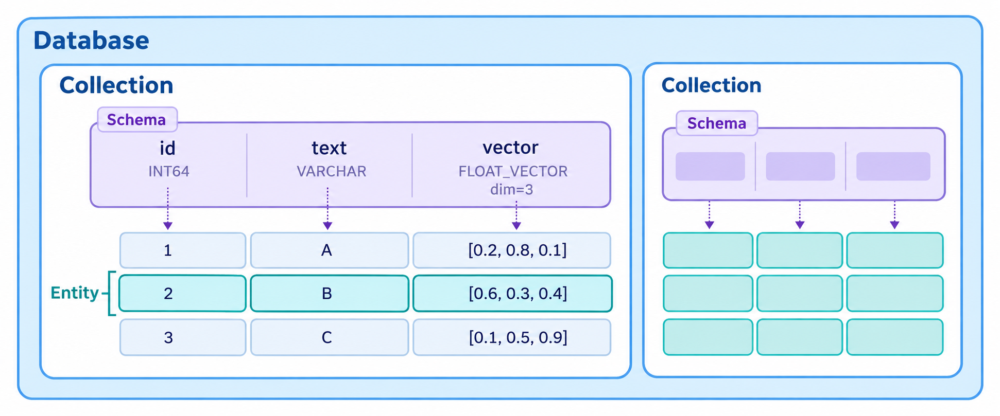

# Milvus DDL



## 环境准备

```python
# !uv add pymilvus
!uv sync
```

```python
from pymilvus import AsyncMilvusClient

client = AsyncMilvusClient(uri="http://127.0.0.1:19530")
```

## Database

```python
# 得到当前所有的数据库
await client.list_databases()
```

```python
# 创建数据库
db_name = "deal_pilot"
if db_name not in await client.list_databases():
    await client.create_database(db_name)
```

```python
# 使用指定的数据库
await client.use_database(db_name)
```

```python
# 删除数据库
await client.drop_database(db_name)
```

## Schema

```python
# 创建 Schema

from pymilvus import DataType

schema = client.create_schema(
    auto_id=True, # 实体的ID自动生成
    enable_dynamic_field=True # 允许动态字段，动态字段会收录到隐藏字段 $meta 中
)


schema.add_field(
    field_name="id", datatype=DataType.INT64, is_primary=True
)

schema.add_field(
    field_name="text", datatype=DataType.VARCHAR, max_length=5000
)

schema.add_field(
    field_name="vector", datatype=DataType.FLOAT_VECTOR, dim=1024
)
```

## Collection

```python
# 查询 collections

await client.list_collections()
```

```python
# 创建 collection
collection_name = "feishu_doc"

if collection_name not in await client.list_collections():
    await client.create_collection(
        collection_name=collection_name,
        schema=schema
    )
```

```python
# 删除 collection
await client.drop_collection(collection_name)
```

## Index

Schema 决定数据结构，Index 决定如何检索数据。

Index 作用于 Schema 中的字段，它告诉 Milvus 对于该字段的数据，应该使用何种方式存储和检索。

**必须为向量字段创建索引**，否则无法进行相似度检索。

对于向量字段的索引，关注 **度量类型** 和 **索引类型**。

**度量类型** 决定如何衡量两个向量有多相似。

| 度量类型 | 中文名称 | 比较的是什么 | 分数方向 | 取值范围 |
|---|---|---|---|---|
| **`L2`** | 欧氏距离 | 两个向量在空间中的位置距离 | **越小越相近**，0 表示位置相同 | ≥ 0 |
| **`COSINE`** | 余弦相似度 | 两个向量的方向是否一致，忽略长度差异 | **越大越相近**，1 表示方向相同 | [-1, 1] |
| **`IP`** | 内积 | 对应维度相乘后求和，同时受方向和长度影响 | **越大排名越靠前** | 无固定上下界 |

决策依据：

- 使用[向量模型官方推荐](https://huggingface.co/Qwen/Qwen3-Embedding-0.6B#sentence-transformers-usage)的相似度算法
- 使用`COSINE`为基准，调整算法测试效果

**索引类型** 决定如何存储向量数据，以及如何检索向量数据。

| 索引类型 | 怎样检索 | 主要作用与代价 |
|---|---|---|
| **FLAT** | 把查询向量与所有向量逐一比较 | 精确检索，不漏掉最近邻；数据量大时计算开销高 |
| **IVF_FLAT** | 先把向量聚成多个簇，检索时选择部分相近的簇，在其中逐一比较 | 缩小搜索范围、加快检索；未搜索的簇中可能有遗漏结果 |
| **IVF_SQ8** | 在 IVF 分簇的基础上，把向量数值压缩为 8 位表示 | 减少内存占用；压缩会引入误差 |
| **IVF_PQ** | 在 IVF 分簇的基础上，将向量分段并编码压缩 | 进一步节省内存；通常需要承担更多精度损失 |
| **HNSW** | 把向量连接成多层邻居图，沿着图逐步接近目标 | 通常检索快、召回率高；维护图结构需要额外内存 |
| **DISKANN** | 使用适合磁盘访问的邻居图，把主要结构放在 SSD 上 | 支持超过内存容量的大规模数据；性能依赖磁盘 I/O |

ANN（Approximate Nearest Neighbor，近似最近邻搜索），指的是：在大量向量中，快速找出与查询向量最接近的一批向量，允许结果存在少量误差。

常见的 ANN 索引方法包括 HNSW、IVF。在 RAG 中，ANN 通常用于从大量文档切片中快速召回与用户问题相关的内容。

```python
# 创建索引

# 准备索引参数
index_params = client.prepare_index_params()
# 添加1个或多个索引参数
index_name = "vector_index"
index_params.add_index(
    field_name="vector",
    index_name=index_name,
    index_type="HNSW",
    metric_type="COSINE",
)

# 为指定 Collection 添加索引
await client.create_index(
    collection_name=collection_name, 
    index_params=index_params,
    sync=False
)
```

```python
# 查看所有索引
await client.list_indexes(collection_name=collection_name)
```

```python
# 查看某个索引的详细情况
await client.describe_index(
    collection_name=collection_name,
    index_name=index_name
)
```

```python
# 删除索引
await client.drop_index(
    collection_name=collection_name, index_name=index_name
)
```
