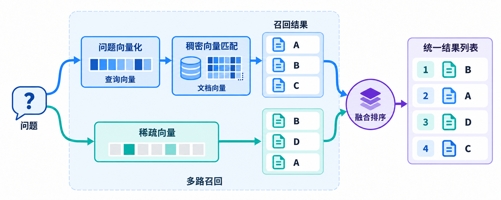

# 多路召回 + 融合排序



```python
from deal_pilot.rag.store.feishu_doc.get_store import get_store

store = await get_store()
```

```python
question="你有没有A200的产品图？"
```

```python
results = await store.asimilarity_search_with_score(
    query=question,  # 查询文本；dense 路生成 embedding，sparse 路交给内置 BM25 分析
    fetch_k=10,  # 每一路最多召回 10 条候选，默认 4；两路候选可能重合
    k=4,  # 融合后最多返回 4 条，默认 4；候选不足时可能更少
    param=[  # 默认 None，沿用 store 的检索参数；列表顺序须对应 [dense, sparse]
        # 第一路：dense。以下配置适用于 HNSW + COSINE，须与集合实际索引匹配。
        {
            "metric_type": "COSINE",
            "params": {
                "ef": 64,  
                "radius": 0.5
            },
        },
        # 第二路：sparse，内置 BM25 全文检索。
        {
            "metric_type": "BM25",
            "params": {},
        },
    ],
    expr='node_title like "%A200%"',  # 默认 None；同一过滤表达式在两路召回前生效
)
```

```python
[
    {"doc":doc, "score":score}
    for doc, score in results
    if score >= 0.03
]
```

## 使用 RRF 融合算法

**RRF = Reciprocal Rank Fusion，倒数排名融合。**

对每篇候选文档，把它在各路中的名次转换成分数后相加：

$$
S_{\mathrm{RRF}}(d)=\sum_{i:\,d\in L_i}\frac{1}{k+\operatorname{rank}_i(d)}
$$

- $L_i$：第 $i$ 路返回的候选列表。
- $\operatorname{rank}_i(d)$：文档在这一路的名次，从 1 开始。
- $k$：平滑参数，常用值为 60。
- 某一路未召回该文档时，这一路的贡献为 **0**。

例如文档 A 在两路分别排第 3、第 1：

$$
S(A)=\frac{1}{60+3}+\frac{1}{60+1}\approx0.032266
$$

RRF 使用名次，不直接比较 COSINE 与 BM25 的原始分数。多路都把某篇文档排在前面时，它通常更容易获得较高的融合分数。

参考：[Milvus RRF Ranker](https://milvus.io/docs/rrf-ranker.md)。

```python
from pymilvus import Function, FunctionType

# 融合方式一：RRF，按各路名次融合，不直接相加 COSINE 与 BM25 原始分数。
rrf_reranker = Function(
    name="dense_sparse_rrf",
    input_field_names=[],
    function_type=FunctionType.RERANK,
    params={
        "reranker": "rrf",
        "k": 60,  # 平滑参数，默认 60；越大越弱化头部名次差异
    },
)
```

```python

await store.asimilarity_search_with_score(
    query=question,  # 查询文本；dense 路生成 embedding，sparse 路交给内置 BM25 分析
    fetch_k=10,  # 每一路最多召回 10 条候选，默认 4；两路候选可能重合
    k=4,  # 融合后最多返回 4 条，默认 4；候选不足时可能更少
    param=[  # 默认 None，沿用 store 的检索参数；列表顺序须对应 [dense, sparse]
        # 第一路：dense。以下配置适用于 HNSW + COSINE，须与集合实际索引匹配。
        {
            "metric_type": "COSINE",
            "params": {
                "ef": 64,  
                "radius": 0.5
            },
        },
        # 第二路：sparse，内置 BM25 全文检索。
        {
            "metric_type": "BM25",
            "params": {},
        },
    ],
    expr='node_title like "%A200%"',  # 默认 None；同一过滤表达式在两路召回前生效,
    reranker=rrf_reranker,  
)
```

## 使用 weighted 融合算法

加权融合既看检索分数，也看每路的重要程度：

$$
S_{\mathrm{weighted}}(d)=w_{\mathrm{dense}}\widetilde{s}_{\mathrm{dense}}(d)
+w_{\mathrm{BM25}}\widetilde{s}_{\mathrm{BM25}}(d)
$$

其中 $\widetilde{s}$ 是经过归一化、统一为“越大越好”的分数。某一路未召回文档时，**该路贡献为 0**。

为什么先归一化？假设同一文档的 COSINE 分数是 `0.8`，BM25 分数是 `8.0`，这不表示 BM25 认为它“相关十倍”。两种分数的定义、范围不同，直接相加会造成尺度偏差。

Milvus 的 `WeightedRanker` 默认启用 `norm_score=True`，按度量类型变换分数；不要把它理解为对当前候选列表统一做一次 min-max。对于本课的 COSINE + BM25，保留归一化配置。

下面直接给定一组**假设已经归一化**的教学分数，用来观察权重的作用，不模拟 Milvus 的内部归一化过程。

参考：[Milvus Weighted Ranker](https://milvus.io/docs/weighted-ranker.md)。

```python
from pymilvus import Function, FunctionType

# 融合方式二：先归一化各路分数，再加权求和；调用时替换 reranker 即可。
weighted_reranker = Function(
    name="dense_sparse_weighted",
    input_field_names=[],
    function_type=FunctionType.RERANK,
    params={
        "reranker": "weighted",
        "weights": [0.7, 0.3],  # 顺序对应 [dense, sparse]；每项在 [0, 1]，这里合计为 1
        "norm_score": True,  # 默认 True；两路分数量纲不同，保留归一化
    },
)
```

```python

await store.asimilarity_search_with_score(
    query=question,  # 查询文本；dense 路生成 embedding，sparse 路交给内置 BM25 分析
    fetch_k=10,  # 每一路最多召回 10 条候选，默认 4；两路候选可能重合
    k=4,  # 融合后最多返回 4 条，默认 4；候选不足时可能更少
    param=[  # 默认 None，沿用 store 的检索参数；列表顺序须对应 [dense, sparse]
        # 第一路：dense。以下配置适用于 HNSW + COSINE，须与集合实际索引匹配。
        {
            "metric_type": "COSINE",
            "params": {
                "ef": 64,  
                "radius": 0.5
            },
        },
        # 第二路：sparse，内置 BM25 全文检索。
        {
            "metric_type": "BM25",
            "params": {},
        },
    ],
    expr='node_title like "%A200%"',  # 默认 None；同一过滤表达式在两路召回前生效,
    reranker=weighted_reranker,  
)
```
