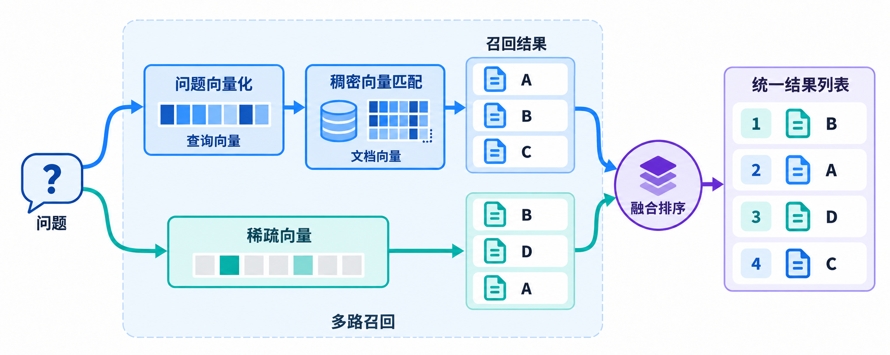

# LLM Reranker

RRF 按名次融合，weighted 按分数融合；模型重排直接读取问题和候选正文，判断相关性。

## 配置 LiteLLM 网关

- 模型名称：`qwen3-rerank`
- API Base: `https://llm-bxsnzgjeej076kci.cn-beijing.maas.aliyuncs.com/compatible-api/v1`
- API Key: `自行配置`
- 分组名：`rerank`

## Rerank 接口测试

```python
import httpx

RERANK_API_KEY = "sk-zCjzfRyCk5KGoEzLvhK20Q"  # 填写 LiteLLM 网关的 API KEY
RERANK_ENDPOINT = "http://localhost:4000/rerank"  # LiteLLM使用Cohere的兼容接口
RERANK_MODEL = "rerank"
```

```python
question = "你有没有 A200 的产品图？"

# 教学候选：同型号参数、其他型号图库、同型号视觉素材、同型号售后。
documents = [
    "A200 产品参数：额定功率 200W，支持三档调节，整机重量 1.5kg。",
    "A300 产品图库：包含正面、侧面和使用场景图，可供宣传物料使用。",
    "A200 视觉素材包：包含白底主图、细节特写和场景展示图，可下载用于商品详情页。",
    "A200 售后流程：提交订单号后，客服会协助处理维修和退换货。",
]
```

```python
async with httpx.AsyncClient(timeout=60) as client:
    response = await client.post(
        RERANK_ENDPOINT,
        headers={"Authorization": f"Bearer {RERANK_API_KEY}"},
        json={
            "model": RERANK_MODEL,
            "query": question,
            "documents": documents,
            "top_n": 4,
        },
    )
    response.raise_for_status()
    payload = response.json()

payload
```

## 使用 Milvus 模型排序

**两路召回 → Milvus 调用 rerank → 返回 Top K**

运行后续代码前先配置好 `docker/milvus/user.yaml`

然后执行：`docker compose restart milvus`

```python
from deal_pilot.rag.store.feishu_doc.get_store import get_store
from pymilvus import Function, FunctionType

store = await get_store()
```

```python
model_reranker = Function(
    name="qwen_rerank",
    input_field_names=["text"],  # 用于评分的正文字段
    function_type=FunctionType.RERANK,
    params={
        "reranker": "model",
        "provider": "cohere",
        "model_name": "rerank",
        "queries": [question],
    },
)

results = await store.asimilarity_search_with_score(
    query=question,
    fetch_k=20,  # 每路最多召回 20 条候选
    k=4,  # 模型排序后最多返回 4 条
    reranker=model_reranker,
)

[{"doc": doc, "score": score} for doc, score in results]
```
