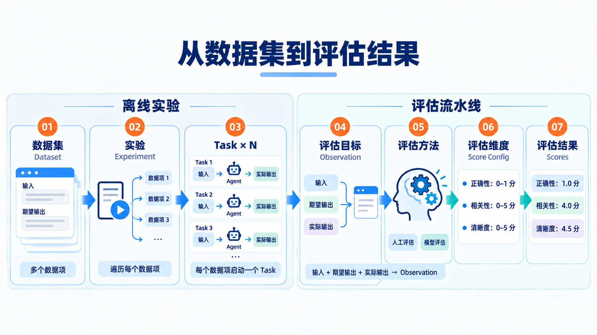

> 学习评估重点关注评估方法和流程，而不是课堂上的评估内容

## 对内容的评估

- **正确性**：回答中的事实、数据和结论是否准确，与可信的标准答案或事实依据一致。
- **完整度**：回答是否覆盖用户问题所需的关键要点、条件和步骤，没有遗漏必要信息。
- **忠实度**：回答中的事实性陈述是否得到检索材料支持，避免编造或无依据的推断。
- **相关性**：回答是否紧扣用户的问题与意图，避免答非所问或加入无关内容。
- **清晰度**：回答是否表达准确、结构清楚，让用户容易理解。
- **简洁性**：回答是否在保留必要信息的前提下，避免重复和冗余。
- **一致性**：回答中的术语、数据和结论是否前后一致，没有相互矛盾。
- **引用准确性**：引用是否指向正确的来源，且该来源确实支持对应的陈述。

## 对检索来源的评估

- **精准率（Precision）**：检索返回的来源中，有多少是真正相关的，∑衡量“找回来的有多准”。

$$
\text{精准率} = \frac{\text{检索返回的相关来源数}}{\text{检索返回的来源总数}} = \frac{|R \cap G|}{|R|}
$$

- **召回率（Recall）**：所有应当找回的相关来源中，实际找回了多少，衡量“该找的找全了多少”。

$$
\text{召回率} = \frac{\text{检索返回的相关来源数}}{\text{应当找回的相关来源总数}} = \frac{|R \cap G|}{|G|}
$$

其中，$R$ 为检索返回的来源集合，$G$ 为评测集中标注的相关来源集合；两者应使用相同的统计粒度，例如都按文档或都按切片统计，并去重。

例如，标注的相关来源有 4 个，检索返回 5 个来源，其中 3 个命中标注，则精准率为 $3/5 = 60\%$，召回率为 $3/4 = 75\%$。
