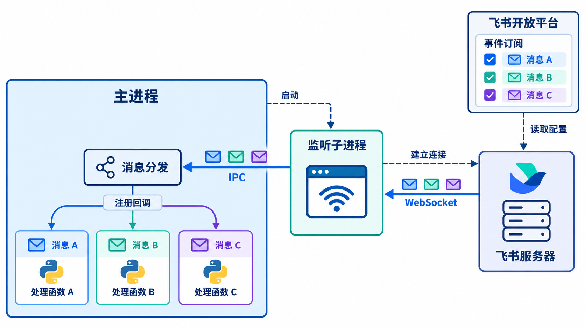

# 飞书消息接口

## 消息监听



支持监听的事件及其事件名称，参见[飞书官方事件列表](https://open.feishu.cn/document/server-docs/event-subscription-guide/event-list)。

基本聊天订阅的是 `im.message.receive_v1`。

字段定义、返回条件和事件体示例，参见[飞书官方：接收消息](https://open.feishu.cn/document/server-docs/im-v1/message/events/receive)。

通用事件格式参见[飞书官方：事件概述](https://open.feishu.cn/document/uAjLw4CM/ukTMukTMukTM/event-subscription-guide)。

## 消息发送

```python
from deal_pilot.feishu.api import MessageAPI

msg_api = MessageAPI()
await msg_api.send_text("open_id", "消息内容")
```

