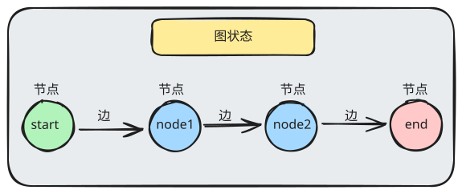
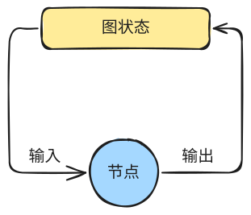

# langgraph 核心概念

## 安装

```python
!uv add langgraph=="1.2.10"
```

## 第一个 langgraph 程序

```python
from langgraph_python.graph.my_first_graph import workflow

graph = workflow.compile()

graph.invoke({})
```

```python
from langchain_core.runnables import Runnable
print(isinstance(graph, Runnable))
```

## 核心概念



### 三个阶段

定义 -> 编译 -> 运行

1. **定义**

   - 节点
   - 边
   - 图状态结构

2. **编译**

   定义好的图是不可运行的，它只是一个描述。

   若要运行图，需要进行编译

   编译好的图，节点和边会固定下来，不能动态变化。

3. **运行**

   编译结果可以运行。

   > langgraph 底层使用 Pregel 系统运行图
   >
   > Pregel来自2010年的谷歌论文，论文中详细阐述了图的执行。
   >
   > https://dl.acm.org/doi/10.1145/1807167.1807184

### 节点

节点可以接收以下类型：
- 可调用对象：实现了`__call__`的对象
- Runnable对象：`Runnable`是`langchain_core`中定义的类型

```python
from langchain_core.runnables import Runnable

print(hasattr(Runnable, "invoke"))      # 执行
print(hasattr(Runnable, "ainvoke"))     # 异步执行
print(hasattr(Runnable, "stream"))      # 流式执行
print(hasattr(Runnable, "astream"))     # 异步流式执行
print(hasattr(Runnable, "batch"))       # 批量执行
print(hasattr(Runnable, "abatch"))      # 异步批量执行
```

### 图状态

图状态是整张图的共享数据空间，图在执行期间，每个节点都可以获取到完整的图状态，也可以更新图状态。

图执行完后，得到的结果就是最新的图状态。



图状态本质上是一个字典，字典的每一个字段称之为 channel （通道）
