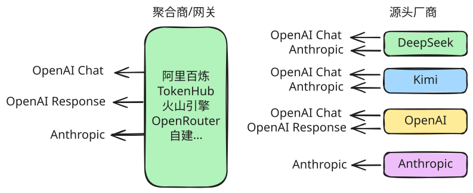
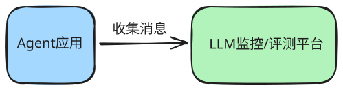

# 环境搭建

## 供应商选择



|                     | 推理成本               | 开发成本 | 运维成本 | 服务器成本 | 适用                   |
| ------------------- | ---------------------- | -------- | -------- | ---------- | ---------------------- |
| 聚合商              | 自有模型低，三方模型高 | 低       | 低       | 无         | 中小型企业             |
| 源头厂商 + 自建网关 | 低                     | 低       | 低       | 高         | 大中型企业             |
| 源头厂商 无网关     | 低                     | 中       | 高       | 无         | 学习<br />快速原型迭代 |


任务：
1. 完成阿里百炼平台的`API-KEY`申请
2. 配置环境变量

```python
!uv add pydantic-settings==2.14.1
```

```python
# 读取环境变量
from langgraph_python.core.config import anthropic_settings, openai_settings
```

```python
openai_settings
```

```python
anthropic_settings
```

## 监控/评测平台

https://smith.langchain.com/


