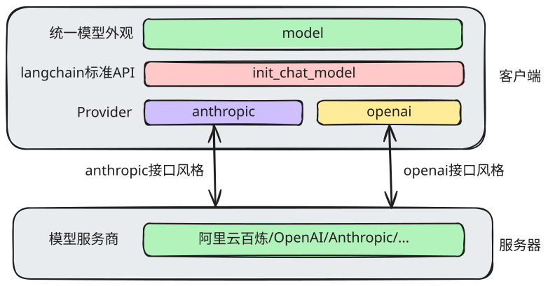

# 模型 Model

langchain官网：https://docs.langchain.com/oss/python/langchain/agents

## 核心理解



model 是 LangChain 的核心组件，它抽象了不同模型的调用差异，对外提供统一外观

## 创建模型

```python
!uv add langchain==1.3.14 
!uv add langchain-openai==1.4.1
!uv add langchain-anthropic==1.5.3
```

```python
from langgraph_python.core.config import openai_settings, anthropic_settings
from langchain.chat_models import init_chat_model

model = init_chat_model(
    model_provider="anthropic",
    model=anthropic_settings.default_model
)
```

```python
response = await model.ainvoke("你好")
```

```python
print(f"返回类型：{type(response)}")
print(f"回复文本：{response.text}")
print(f"工具调用：{response.tool_calls}")
print(f"响应块：{response.content_blocks}")
print(f"额外信息：{response.additional_kwargs}")
print(f"token消耗：{response.usage_metadata}")
```

## OpenAI接口的问题

OpenAI 官方接口标准中，不暴露思维链

目前社区的解决办法：

- 自定义 Provider
- 使用 Anthropic 接口
- 换其他第三方的集成（例如 OpenRouter）
- 抛弃 `langchain` 的 `model`，通过 `OpenAI SDK` 自行封装

## 流式传输

```python
chunks = model.astream("你好")
async for chunk in chunks:
    for block in chunk.content_blocks:
        print(block)
```

## 消息

```python
from langchain.messages import HumanMessage, SystemMessage, AIMessage, ToolMessage

# user、system、assistant、tool

messages = [
    SystemMessage("请使用猪八戒的语气回复"), # role:system
    HumanMessage("你好，呆子") # role:user
]

response = await model.ainvoke(messages) # 返回AIMessage
```

## 多轮对话

```python
messages.append(response)
messages.append(HumanMessage("想挨棍子了？"))
```

```python
messages
```

```python
response = await model.ainvoke(messages)
```

## 工具

```python
from langchain.tools import tool

# 定义工具
@tool
def get_weather(location: str) -> str:
    """
    获取天气

    参数：
    - location: 城市名称
    """
    return f"It's sunny in {location}."

# 绑定工具
model_with_tools = model.bind_tools([get_weather])

response = await model_with_tools.ainvoke("伦敦的天气如何？")
```

```python
from langchain_core.runnables import Runnable
```

```python
print(isinstance(get_weather, Runnable))
print(isinstance(model, Runnable))
```
