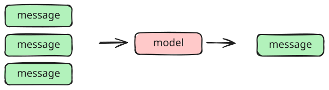

补充一个小技巧

1. 快捷键 `Ctrl+,`（Windows/Linux）/ `Cmd+,`（Mac）打开设置

2. 搜索框输入：`files.exclude`

3. 点击**添加模式**，填入：

    ```
    **/__pycache__
    **/__init__.py
    **/py.typed
    ```

安装插件：Toggle Excluded Files

```python
from langgraph_python.core.create_model import create_model

model = create_model()
```

# 消息



## 消息类型

```python
from langchain.messages import HumanMessage, SystemMessage, AIMessage, ToolMessage

messages = [
    SystemMessage("你是一个智能天气助手。"),
    HumanMessage("你好！请问今天成都的天气怎么样？我下午想去公园散步。"),
    AIMessage(
        content="",
        content_blocks=[{
            "type": "reasoning",
            "reasoning": "我需要调用get_weather工具获取准确的天气数据。"
        }],
        tool_calls=[{
            "id": "call_123456",
            "name": "get_weather",
            "args": {
                "city": "成都"
            }
        }]
    ),
    ToolMessage(
        content="成都今天是晴天，气温 25°C",
        tool_call_id="call_123456"  # 必须与AI消息中的tool_calls id匹配
    )
]
await model.ainvoke(messages)
```

```python
# 所有的消息都继承自 BaseMessage
from langchain.messages import HumanMessage, SystemMessage, AIMessage, ToolMessage
from langchain_core.messages import BaseMessage

print(
    issubclass(SystemMessage, BaseMessage),
    issubclass(HumanMessage, BaseMessage),
    issubclass(AIMessage, BaseMessage),
    issubclass(ToolMessage, BaseMessage),
)
```

## 消息格式

### 纯文本消息

略

### 图片消息

```python
# 通过 URL 或 base64 编码的图片数据来发送图片消息
url1="https://fastly.picsum.photos/id/57/800/600.jpg?hmac=Geuc5OABDrI_1EI9yvAjSWKQpjo0S6g9Y5mB9JxI4r8"
url2="https://fastly.picsum.photos/id/58/800/600.jpg?hmac=yQHfIMWMXYg4f264WBOGMBWTYbv6NqTJMVz7r67kN3w"
messages = [
    # 一个HumanMessage可以有多个content_block
    HumanMessage([
        {"type": "text", "text": "比较这两张图片风格的差异"},
        {"type": "image", "url": url1},
        {"type": "image", "url": url2}
        # {"type": "image", "base64": "...", "mine_type": "image/png"}  
    ])
]
await model.ainvoke(messages)
```

### 音频消息

注意：需要模型支持ASR能力，否则会报错。本节的示例使用支持ASR的模型。

> 百炼平台没有免费的ASR模型，注意运行期间会产生费用

```python

import base64
with open("./assets/audio/test.mp3", "rb") as f:
    audio_base64 = base64.b64encode(f.read()).decode()
data_url = f"data:audio/mpeg;base64,{audio_base64}"

asr_model = create_model(
    model_name="qwen3.5-omni-plus",
    provider="openai_reasoning"
)

messages = [
    HumanMessage([
        {"type": "text", "text": "请告诉我这段音频的内容"},
        {"type": "audio", "base64": data_url, "mime_type": "audio/mpeg"}
    ])
]

await asr_model.ainvoke(messages)
```

### 更多消息格式

其他消息格式需要模型、模型服务商和提供程序的支持

https://docs.langchain.com/oss/python/langchain/messages#content-block-reference

## 消息模板

```python
from langchain_core.utils.mustache import render

result = render(
    template="Hello {{name}}, you have {{count}} messages", 
    data={"name": "世界", "count": 3}
)

print(result)   # Hello 世界, you have 3 messages
```

```python
# 使用封装
from langgraph_python.template import prompt_from_filename

prompt_from_filename(
    filename="system",
    data={"cwd":"/yuanjin", "os":"mac", "is_git": True}
)
```
