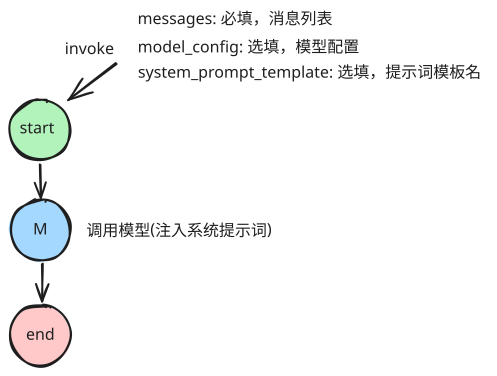

# Reducer

## Reducer 的本质

Reducer 在 Python 中表达为一个函数，它规定了两个数据（前一个、后一个）如何合并为一个新数据。

```python
# 通过相加合并
def add(a, b):
    return a + b

# 始终使用新数据覆盖旧数据
def overwrite(a, b):
    return b
```

```python
print(add(1, 2))
print(add([1,2], [3,4]))
print(add("a", "b"))
```

```python
import operator # 使用 python 自带的 operator 模块

print(operator.add(1, 2))
print(operator.add([1,2], [3,4]))
print(operator.add("a", "b"))
```

## State 中的 Reducer

在 LangGraph 中，状态中的每一个通道都会对应到一个 Reducer，如果没有指定，它会默认使用覆盖 Reducer。

在 LangGraph 中，它要求 Reducer 的返回类型要保持一致。

```python
from typing import List, Annotated, TypedDict, NotRequired
import operator

class MyState(TypedDict):

    # 覆盖 reducer
    covered: NotRequired[str]
    
    # 追加 reducer
    append_list: NotRequired[Annotated[List[str], operator.add]]

    # 保留最大值的 reducer
    high_score: NotRequired[Annotated[int, lambda a,b:max(a,b)]]

```

```python
# 测试

def node1(state: MyState):
    print("进入node1的状态：", state)
    return {
        "covered": "node1 result", 
        "append_list": ["node1 result"],
        "high_score": 5
    }

def node2(state: MyState):
    print("进入node2的状态：", state)
    return {
        "covered": "node2 result", 
        "append_list": ["node2 result"],
        "high_score": 3
    }

from langgraph.graph import StateGraph, START, END

# 创建图
workflow = StateGraph(MyState)
(
    workflow.add_node(node1)
    .add_node(node2)
    .add_edge(START, "node1")
    .add_edge("node1", "node2")
    .add_edge("node2", END)
)

# 编译图
graph = workflow.compile()

# 执行
await graph.ainvoke({})
```

## 内置的Reducer: add_messages

```python
from langchain.messages import SystemMessage, HumanMessage, AIMessage
messages = [
    SystemMessage("系统消息", id=1),
    HumanMessage("用户消息1", id=2)
]
```

```python
from langgraph.graph.message import add_messages


messages = add_messages(messages, [
    AIMessage("AI回复1", id=3),
    HumanMessage("用户消息2", id=4)
])
messages
```

```python
messages = add_messages(messages, AIMessage("AI回复2", id=5))
messages
```

```python
messages = add_messages(messages, AIMessage("AI回复1-改", id=3))
messages
```

## 工程推进

### 目录结构

```yaml
langgraph_python
├── 📁 core          # 核心功能：模型、核心配置
├── 📁 graphs        # 各种图
├── 📁 nodes         # 节点
├── 📁 states        # 图状态声明
├── 📁 templates     # 提示词模板
```

### 图结构



### 测试


```python
from langgraph_python.graphs.core_agent_graph import build_graph

graph = build_graph().compile()

await graph.ainvoke({
    "messages":[
        HumanMessage("你好")
    ]
})
```
