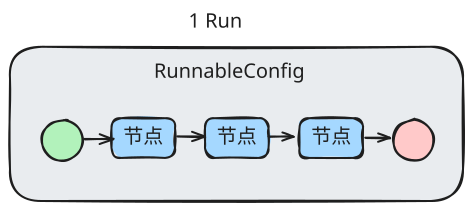

# RunnableConfig



## 注入和读取配置

```python
from typing_extensions import TypedDict
from langchain_core.runnables import RunnableConfig, ensure_config
from langgraph.graph import StateGraph


class State(TypedDict):
    pass


# 第一个节点：通过依赖注入读取 RunnableConfig
def node_di(state, config: RunnableConfig):
    return {}


# 第二个节点：通过 ensure_config 读取 RunnableConfig
def node_ensure(state):
    config = ensure_config()
    return {}


builder = StateGraph(State)
builder.add_node(node_di)
builder.add_node(node_ensure)
builder.set_entry_point("node_di")
builder.add_edge("node_di", "node_ensure")
builder.set_finish_point("node_ensure")

graph = builder.compile()

await graph.ainvoke(
    input={}, 
    config={
        "configurable": {
            "a": "1"
        }
    }
)
```

## 动态改变模型配置

- 其他功能上节课已完成
- 修改`call_model`节点，当模型名称为`fake`时，使用`mock_model`

```python
from langgraph_python.graphs.core_agent_graph import build_graph
from langchain.messages import HumanMessage

graph = build_graph().compile()
```

```python
await graph.ainvoke(
    input={
        "messages": [HumanMessage("你好，你是谁？")]
    },
    config={
        "configurable": {
            "model": "fake"
        }
    }
)
```

## 动态决定系统提示词

1. 去掉系统提示词模板
2. 去掉图状态中的系统提示词
3. `call_model`节点需要动态读取系统提示词配置

```python
await graph.ainvoke(
    input={
        "messages": [HumanMessage("你好，你是谁？")]
    },
    config={
        "configurable": {
            "system_prompt": "你是一个金融分析师"
        }
    }
)
```

## 动态决定工具列表

1. 修改`tools/__init__.py`，支持按照字符串列表返回工具列表
2. 修改`call_model`节点，根据配置的工具列表绑定工具

```python
await graph.ainvoke(
    input={
        "messages": [HumanMessage("你绑定了哪些工具？")]
    },
    config={
        "configurable": {
            "tools": ["get_current_time"]
        }
    }
)
```

## 其他预设配置


| 字段 | 作用 |
| --- | --- |
| `configurable` | 用户自定义任意键值 |
| `configurable.thread_id` | 线程id |
| `configurable.max_concurrency` | 一个超步中并行任务数上限 |
| `recursion_limit` | 单次run的超步上限（默认 1000） |
| `tags` | 给这次运行打标签，用于追踪/过滤 |
| `metadata` | 自定义元数据（LangSmith 追踪用） |
| `callbacks` | 回调处理器（监听事件、自定义追踪） |
| `run_name` | 给运行命名 |
| `run_id` | 手动指定运行 ID |

```python
await graph.ainvoke(
    input={
        "messages": [HumanMessage("现在什么时间")]
    },
    config={
        "configurable": {
            "model":"fake",
            "system_prompt":"你是一名金融分析师"
        },
        "recursion_limit": 3,
        "tags": ["金融分析", "fake model"],
        "metadata": {
            "app_version": "0.0.1",
            "env": "dev"
        },
        "run_name": "金融Agent"
    }
)
```
