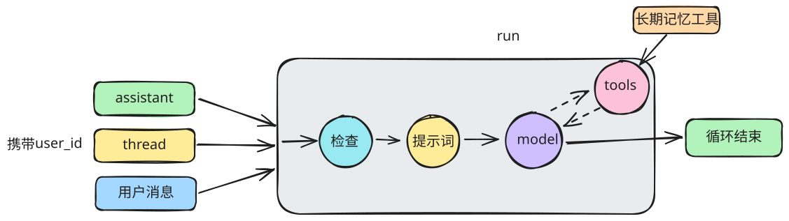

# 长期记忆



1. 新增检查节点`check`
   1. 检查 `runtime` 中是否存在 `store`
   2. 检查 `thread` 中是否包含 `user_id`
2. 新增提示词节点，向图状态注入系统提示词
   1. 图状态中新增系统提示词字段
   2. 提示词节点第一次加载时构建完整系统提示词，保存到图状态
3. 修改模型节点：模型节点直接读取图状态中的系统提示词
4. 新增长期记忆工具

## LangGraph API

直接编译并调用图，测试长期记忆的写入、Thread 快照、跨 Thread 读取和用户隔离。

```python
from langchain_core.messages import HumanMessage
from langchain_core.runnables import RunnableConfig
from langgraph.checkpoint.memory import InMemorySaver
from langgraph.store.memory import InMemoryStore

from langgraph_python.graphs.core_agent_graph import build_graph
from langgraph_python.states.core_agent_state import ContextSchema

# Store 保存跨 Thread 的长期记忆，Checkpointer 保存每个 Thread 的图状态
store = InMemoryStore()
checkpointer = InMemorySaver()
graph = build_graph().compile(
    store=store,
    checkpointer=checkpointer,
)

user_id = "001"
context = ContextSchema(system_prompt="尽量形成长期记忆！")
```

### 1. 在第一个 Thread 中写入长期记忆

```python
thread_1_config: RunnableConfig = {
    "configurable": {"thread_id": "thread-001"},
    "metadata": {"user_id": user_id},
}

result = await graph.ainvoke(
    input={
        "messages": [
            HumanMessage("请记住：我最喜欢的电影是《宇宙探索编辑部》")
        ]
    },
    config=thread_1_config,
    context=context,
)
result["messages"][-1].content
```

```python
# 工具按照 user_id 将记忆写入 Store
memory_item = await store.aget(("users", user_id), key="memory")
memory_item
```

### 2. 当前 Thread 仍然使用第一次运行时的系统提示词快照

长期记忆是在第一次运行期间才写入的，因此当前 Thread 已冻结的系统提示词中还没有这条记忆。

```python
thread_1_state = await graph.aget_state(thread_1_config)
print(thread_1_state.values["system_prompt"])
```

### 3. 同一个用户新建 Thread，读取最新长期记忆

```python
thread_2_config: RunnableConfig = {
    "configurable": {"thread_id": "thread-002"},
    "metadata": {"user_id": user_id},
}

result = await graph.ainvoke(
    input={"messages": [HumanMessage("你知不知道我最喜欢的电影是什么？")]},
    config=thread_2_config,
    context=context,
)
result["messages"][-1].content
```

```python
thread_2_state = await graph.aget_state(thread_2_config)
print(thread_2_state.values["system_prompt"]) 
```

### 4. 用户记忆是隔离的

```python
other_user_config: RunnableConfig = {
    "configurable": {"thread_id": "long-term-memory-thread-003"},
    "metadata": {"user_id": "002"},
}

result = await graph.ainvoke(
    input={"messages": [HumanMessage("我最喜欢的电影是什么")]},
    config=other_user_config,
    context=context,
)
other_user_state = await graph.aget_state(other_user_config)
print(other_user_state.values["system_prompt"])
result["messages"][-1].content
```

## Agent Server API

通过 LangGraph SDK 调用 Agent Server，重复验证相同的长期记忆流程。

运行以下代码前，先在终端执行 `uv run langgraph dev` 启动本地 Agent Server。

```python
from langgraph_sdk import get_client

client = get_client(url="http://localhost:2024")
assistant_id = "46bf8031-082b-4d1d-a8df-9687787d9d40"
# 每次执行生成新用户，避免之前的测试数据影响结果
server_user_id = "003"
```

### 1. 创建 Thread，并通过 Run 写入长期记忆

```python
# 删除所有线程，免得看晕了
threads = await client.threads.search(limit=100)
for t in threads:
    await client.threads.delete(thread_id=t['thread_id'])

server_thread_1 = await client.threads.create(
    metadata={
        "user_id": server_user_id,
        "__name__": "长期记忆测试：写入",
    }
)
server_thread_1_id = server_thread_1["thread_id"]
server_thread_1_id
```

```python
server_result = await client.runs.wait(
    thread_id=server_thread_1_id,
    assistant_id=assistant_id,
    input={
        "messages": [
            {"role": "user", "content": "请记住：我叫黑土，今年75，属虎"}
        ]
    }
)
server_result["messages"][-1]["content"] # type: ignore
```

```python
# 直接通过 Agent Server 的 Store API 检查工具写入的结果
server_memory_item = await client.store.get_item(
    ("users", server_user_id),
    key="memory",
)
server_memory_item["value"]
```

### 2. 检查第一个 Thread 的系统提示词快照

```python
server_thread_1_state = await client.threads.get_state(server_thread_1_id)
print(server_thread_1_state["values"]["system_prompt"]) # type: ignore
```

### 3. 同一个用户新建 Thread，读取最新长期记忆

```python
server_thread_2 = await client.threads.create(
    metadata={
        "user_id": server_user_id,
        "__name__": "长期记忆测试：跨 Thread 读取",
    }
)
server_thread_2_id = server_thread_2["thread_id"]

server_result = await client.runs.wait(
    thread_id=server_thread_2_id,
    assistant_id=assistant_id,
    input={"messages": [{"role": "user", "content": "你知道我是谁吗？"}]}
)
server_result["messages"][-1]["content"] # type: ignore
```

```python
server_thread_2_state = await client.threads.get_state(server_thread_2_id)
print(server_thread_2_state["values"]["system_prompt"]) # type: ignore
```

### 4. 用户记忆是隔离的

```python
other_server_thread = await client.threads.create(
    metadata={
        "user_id": f"004",
        "__name__": "长期记忆测试：用户隔离",
    }
)

server_result = await client.runs.wait(
    thread_id=other_server_thread["thread_id"],
    assistant_id=assistant_id,
    input={"messages": [{"role": "user", "content": "你知道我是谁吗？"}]}
)
other_server_state = await client.threads.get_state(other_server_thread["thread_id"])
print(other_server_state["values"]["system_prompt"]) # type: ignore
server_result["messages"][-1]["content"] # type: ignore
```
