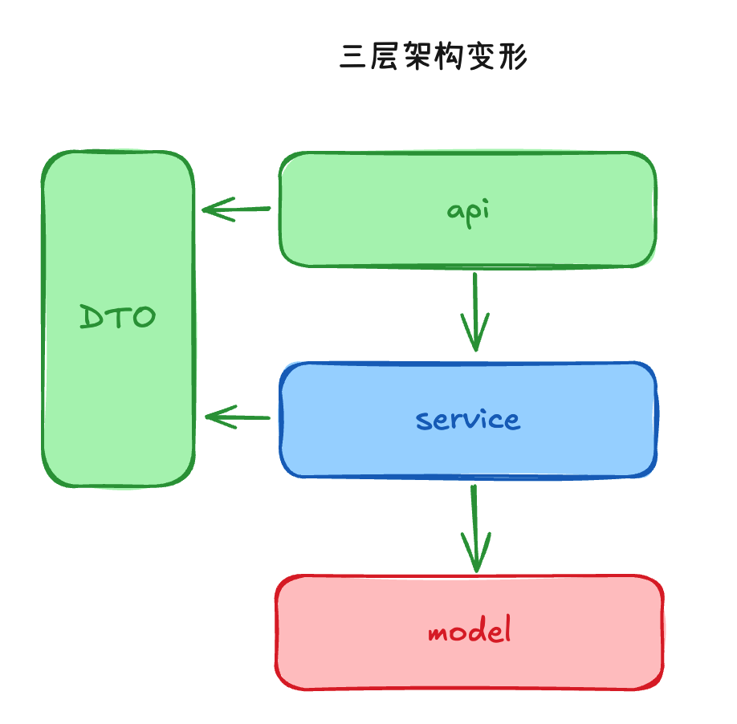
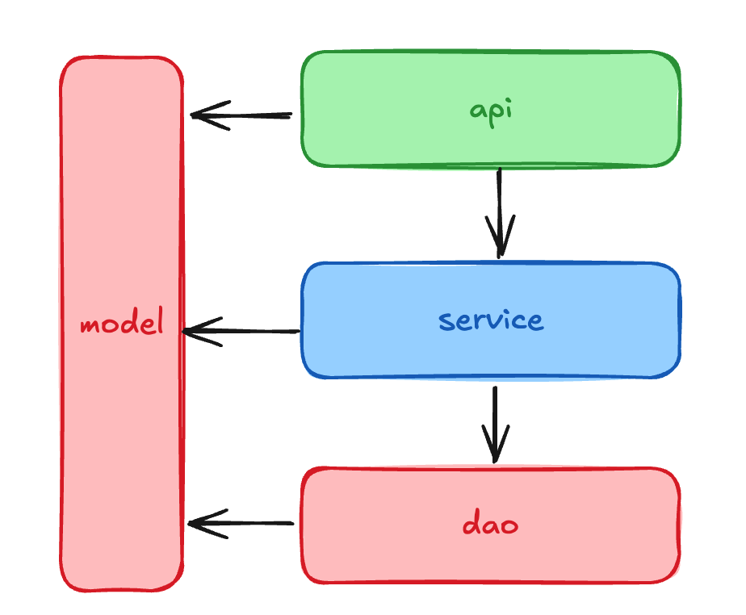
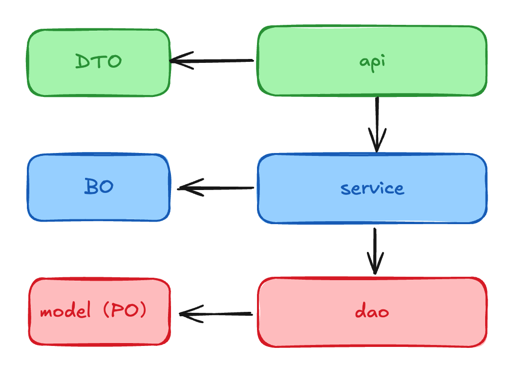
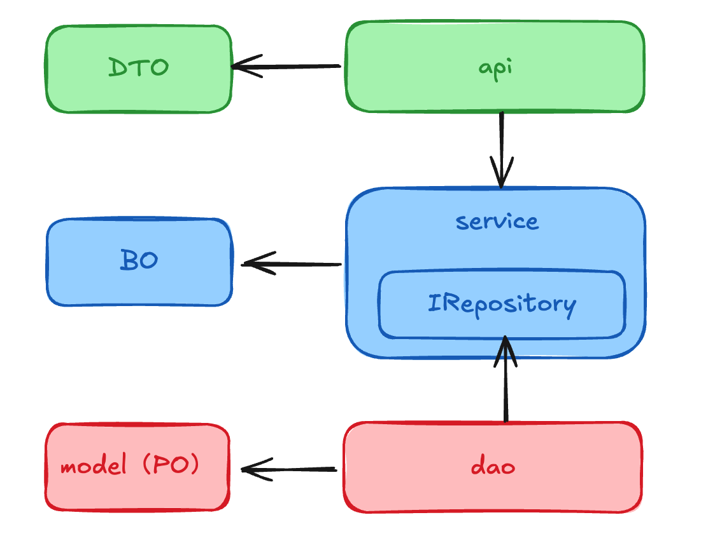

# 三层架构

## 当前的架构



## 经典三层



## 模型分化



示例：

```python
# model


class User:
    id: int
    username: str
    password_hash: str  # 存储加密后的密码
    email: str
    phone: str
    created_at: datetime
    updated_at: datetime
    is_deleted: bool  # 软删除标记


# BO
class UserIdentity:
    username: str
    password_hash: str

class UserInfo:
    email: str
    phone: str

class User:
    id: int
    identity: UserIdentity
    info: UserInfo
    created_at: datetime
    updated_at: datetime

# DTO
class User
    id: int
    username: str
    email: str
```


## 依赖倒置


